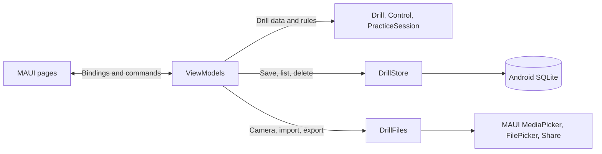

# PanelPlay

[GitHub repository](https://github.com/im-kaami/PanelPlay) · [Quick demo](#quick-demo) · [Architecture](#architecture) · [Build and run](#build-and-run)

PanelPlay is an offline Android app for teaching AV troubleshooting on the layout of equipment a crew actually uses. A trainer photographs a mixer or control panel, marks its switches, and turns that panel into a playable fault scenario. A learner toggles the simulated switches to restore the target setup while keeping protected settings intact.

A labelled photo can show where a switch is. PanelPlay also lets a learner practice deciding which switch to change. Each drill can travel as a single JSON file containing the objective, the panel photo, and the control states. Authoring, storage, and practice run locally on the phone.

## Quick demo

Open **Silent mic · A** or **Silent mic · B** from the library, then tap **Start practice**. In both drills the microphone input is active, the microphone is absent from Main, and music is still playing.

| Drill | Starting fault | Correct action |
| --- | --- | --- |
| **Silent mic · A** | The microphone is muted and already routed to Main. | Switch **Mic mute** off. |
| **Silent mic · B** | The microphone is unmuted and its route to Main is off. | Switch **Mic to Main** on. |

Try **Restart drill**, then change **Music to Main**. That protected setting ends the attempt. Restart again to restore the initial switch states.

## Author and share a drill

1. Tap **New drill** and enter a title and learner task. Use **Photograph panel** to attach a photo. A blank panel also supports pin placement.
2. Tap **Add control**, then tap its location on the panel. Enter its name and choose the starting state, target state, and whether it must stay unchanged. Add up to six controls. At least one control must have different starting and target states.
3. Tap **Save drill**. From the details screen you can preview it, start practice, edit the task or pins, duplicate it under a new record, or delete it after confirmation. A built-in drill can also be used as a template.
4. Tap **Share playable drill** and choose a destination in Android's share sheet. On the receiving phone, save the JSON file locally and tap **Import drill** in PanelPlay. The import gets a new identity, so it can be edited and played independently of the original.

## Architecture

PanelPlay is a C# .NET MAUI application that targets Android. It uses MVVM to keep page layout and interaction, application state, and drill rules in separate classes. [App.cs](PanelPlay/App.cs) starts a MAUI navigation stack with the drill library as its root.



| Layer | Owns |
| --- | --- |
| [Views](PanelPlay/Views) | Five interactive pages for the library, drill details, authoring, control settings, and practice. The pages handle navigation, confirmations, and presentation. `PanelCanvas` renders the panel and maps touches to image coordinates. |
| [ViewModels](PanelPlay/ViewModels) | `DrillLibrary` refreshes the observable list. `DrillDetail` exposes record actions and summaries. `DrillEditor` owns the draft, and `ControlEditor` validates per-switch settings. `PracticeViewModel` exposes switch commands, status, and simulated readings. |
| [Models](PanelPlay/Models) | `Drill` and `Control` define the saved data. `PracticeSession` applies the switch and protection rules. `BuiltInDrills` provides the two mixer examples. |
| [Services](PanelPlay/Services) | `DrillStore` reads and writes SQLite. `DrillFiles` uses native MAUI camera, picker, and sharing APIs and validates drill files. |

The editor uses two-way binding for text and control settings. Observable collections update the library and draft control list, a converter formats control counts, and property changes refresh the practice status and switch labels.

### Data model and persistence

| Model | Data |
| --- | --- |
| `Drill` | A GUID, title, learner task, optional Base64-encoded JPEG, and a list of controls. |
| `Control` | A name, normalized X/Y position, initial and target On/Off states, and a protected flag. An optional mixer role supports the example signal readings. |
| `PracticeSession` | The current switch states, whether all targets have been reached, and whether a protected setting was changed. This state belongs to one attempt in memory. |

SQLite stores one row per saved drill in the app's private `drills.db3` database. Each row has an ID, title, and JSON payload. Creating, duplicating, or importing a drill gives it a new ID. Saving an edit writes back to the existing ID. Reads reconstruct larger JSON payloads in chunks so photos can fit within Android's SQLite cursor limits. Deleting a drill removes its row.

### Practice and native features

- **Practice.** A session copies the starting states from the saved drill. A pin tap or switch button toggles the corresponding state. The fault is resolved when every switch matches its target. Changing a protected switch ends the attempt. Restart restores all starting states. The mixer readings are simulated.
- **Camera.** MAUI MediaPicker captures a JPEG for the draft. The panel keeps the photo's aspect ratio and places pins relative to the displayed image, so their positions stay aligned as it scales.
- **Sharing and import.** MAUI Share passes the JSON file to Android's share sheet. FilePicker reads a local file and checks its size, structure, control settings, and optional JPEG before saving a copy. Sending to a remote destination depends on the selected Android app. Importing a local copy and practicing work offline.

## Build and run

Install the .NET 10 SDK, the MAUI Android workload, JDK 17, and Android SDK Platform 36. The app supports Android API 24 and later. Connect an Android device with USB debugging enabled or start an Android emulator.

```powershell
git clone https://github.com/im-kaami/PanelPlay.git
cd PanelPlay
dotnet workload install maui-android
dotnet build PanelPlay/PanelPlay.csproj
adb install -r PanelPlay/bin/Debug/net10.0-android/app.panelplay.prototype-Signed.apk
```

Open **PanelPlay** from the device launcher. For a custom SDK or JDK location, pass `-p:AndroidSdkDirectory=<path>` and `-p:JavaSdkDirectory=<path>` to the build. The `adb` command comes from Android SDK Platform-Tools.

## Verification

The debug build was exercised on an Android 15 emulator. Checks covered drill creation, editing and deletion across relaunches, pin placement and movement, virtual camera capture and cancellation, delivery to a separate app through the share sheet, importing the attachment in airplane mode, rejection of malformed files, and both mixer drills' resolution, protection, and restart behavior.

## Credits

The launcher icon and mixer illustrations were created for PanelPlay. The project uses [.NET MAUI (MIT)](https://github.com/dotnet/maui/blob/main/LICENSE.txt), its [third-party notices](https://github.com/dotnet/maui/blob/main/THIRD-PARTY-NOTICES.TXT), and Android's [SQLite engine (public domain)](https://www.sqlite.org/copyright.html).
